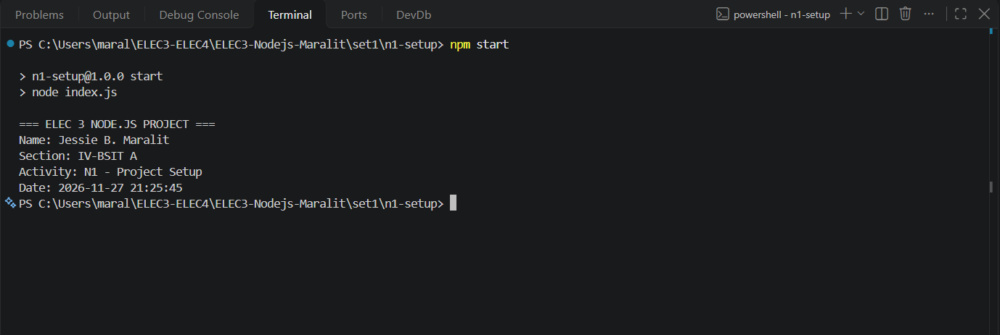

# ELEC 3 - Node.js

Student: Jessie B. Maralit  
Section: IV-BSIT A  
Course: ELEC 3 - Node.js  
Instructor: Carl Gustaf Patrik B. Ferrer

## Self-Paced Learning Activities

### Set 1 - November 23-29, 2026

N1: [Project Setup and Package Management](set1/n1-setup/)  
Initialize a Node.js project, install dependencies, configure package.json, and run a program using npm start.

N2: [Modular Calculator](set1/n2-calculator/)  
A command-line calculator that uses custom modules for addition, subtraction, multiplication, division, and average.

N3: [File Manager with fs and path](set1/n3-file-manager/)  
A Node.js application that creates, reads, updates, deletes, and lists text files using the built-in fs and path modules.

### Set 2 - November 30 to December 6, 2026

N4: Basic HTTP Server  
N5: REST-style API  
N6: Middleware and API Testing  

Set 2 activities will be added after implementation.

## How to Run

### N1 - Project Setup

Open a terminal in the repository root.

```powershell
cd set1/n1-setup
npm install
npm start
```

N1 uses the dayjs package to display the current date and time.

### N2 - Modular Calculator

Run from the repository root:

```powershell
node set1/n2-calculator/index.js add 12 8
node set1/n2-calculator/index.js subtract 20 5
node set1/n2-calculator/index.js multiply 6 7
node set1/n2-calculator/index.js divide 20 4
node set1/n2-calculator/index.js average 80 90 100
```

Error testing:

```powershell
node set1/n2-calculator/index.js divide 10 0
node set1/n2-calculator/index.js unknown 10 5
```

### N3 - File Manager

Run from the repository root:

```powershell
node set1/n3-file-manager/index.js list
node set1/n3-file-manager/index.js read notes.txt
node set1/n3-file-manager/index.js update notes.txt "New information"
node set1/n3-file-manager/index.js create sample.txt "Hello"
node set1/n3-file-manager/index.js delete sample.txt
```

The program stores its text files inside the n3-file-manager/files folder.

## Activity Screenshots

### N1 - Project Setup



### N2 - Modular Calculator


### N3 - File Manager


## GitHub Workflow

The Set 1 activities were developed in the set-1 branch using meaningful commits.

The completed set will be merged into main through a GitHub pull request.

The node_modules folder is excluded using .gitignore.
