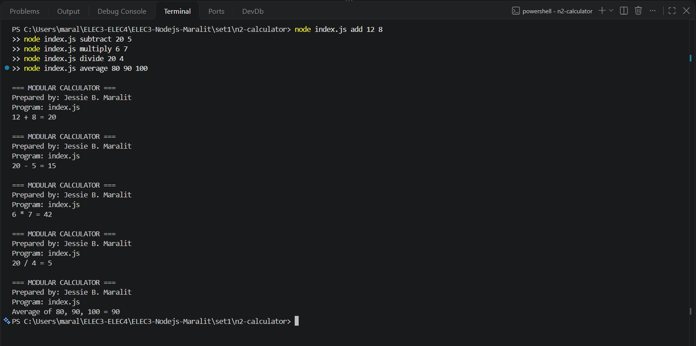
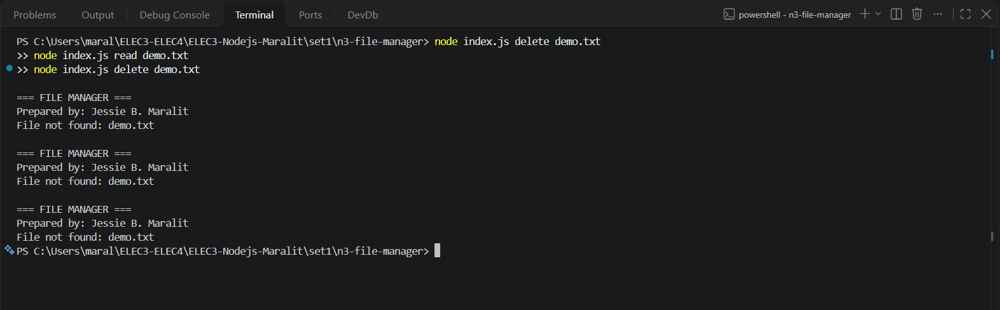


# ELEC 3 - Node.js

Student: Jessie B. Maralit
Section: IV-BSIT A
Course: ELEC 3 - Node.js
Instructor: Carl Gustaf Patrik B. Ferrer

## Set 1 Activities

N1: [Project Setup and Package Management](set1/n1-setup/)
- Initialize a Node.js project using npm.
- Install regular and development dependencies.
- Configure package.json and run npm start.

N2: [Modular Calculator](set1/n2-calculator/)
- Perform addition, subtraction, multiplication, division, and average.
- Use custom modules, require(), module.exports, and process.argv.
- Handle division by zero and unknown operations.

N3: [File Manager](set1/n3-file-manager/)
- Create, read, update, delete, and list text files.
- Use the built-in fs and path modules.
- Handle missing files.

## How to Run

### N1 - Project Setup

From the repository root:

1. cd set1/n1-setup
2. npm install
3. npm start

To return to the repository root: cd ../..

### N2 - Modular Calculator

From the repository root:

- node set1/n2-calculator/index.js add 12 8
- node set1/n2-calculator/index.js subtract 20 5
- node set1/n2-calculator/index.js multiply 6 7
- node set1/n2-calculator/index.js divide 20 4
- node set1/n2-calculator/index.js average 80 90 100

Error tests:

- node set1/n2-calculator/index.js divide 10 0
- node set1/n2-calculator/index.js unknown 10 5

### N3 - File Manager

From the repository root:

- node set1/n3-file-manager/index.js create sample.txt "Hello"
- node set1/n3-file-manager/index.js read sample.txt
- node set1/n3-file-manager/index.js update sample.txt "New text"
- node set1/n3-file-manager/index.js list
- node set1/n3-file-manager/index.js delete sample.txt

## Screenshots

### N1 - Project Setup

### N2 - Modular Calculator

### N3 - File Manager

## Written Answers

[N1 Package Management Answers](set1/n1-setup/N1_answers.docx)

## Set 2 Activities

N4: Basic HTTP Server

N5: REST-style API

N6: Middleware and API Testing

Set 2 activities will be added after implementation.
